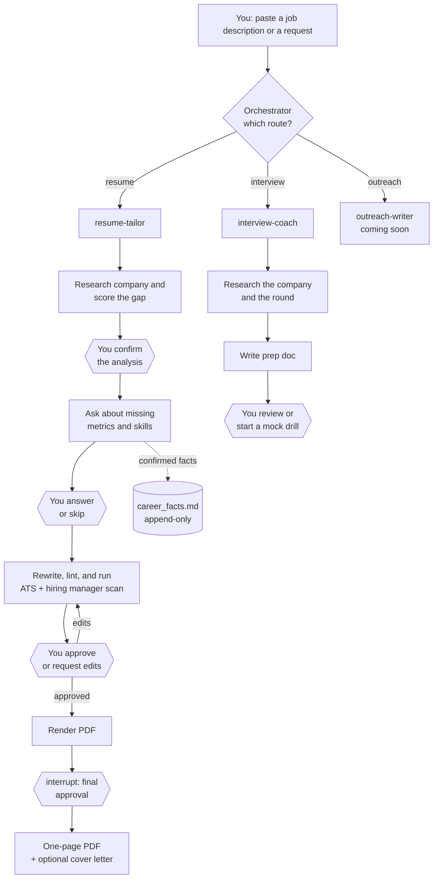

# Career Agent

> A multi-agent job hunting sidekick built on LangGraph. It tailors my resume, preps me for interviews, and (soon) writes my cold outreach. It also refuses to make things up about me, which is more than I can say for most resume tools.

**Status: work in progress.** Some parts work end to end, some are half built, and one is still just a plan. Details below.

---

## Why I built this

I wanted a real project to practice building agents, not another chatbot demo. Job hunting turned out to be a good fit. It has messy inputs (job descriptions), a strict source of truth (my actual experience), several steps that need a human to say "yes" or "no, change that", and outputs that have to look good on paper.

So this repo is my playground for:

- **Multi-agent design.** One orchestrator that routes requests to specialist subagents.
- **Human in the loop.** LangGraph `interrupt()` to pause the graph and wait for my approval before anything final happens.
- **Staged workflows.** Long tasks broken into stages, with state saved to disk so a subagent can pick up exactly where it left off.
- **Agent Skills.** Short prompts, with the actual "how to do this well" knowledge kept in reusable `SKILL.md` files.
- **Guardrails that are code, not vibes.** A deterministic style linter, an append-only facts file, and file permissions the agent can't talk its way around.
- **Observability and testing.** Every run traced in LangSmith, unit tests for the tools, and an eval plan for the prompts.

## What it does (the goal)

| Route | What you give it | What you get back | Status |
|---|---|---|---|
| 1. Resume tailoring | A job description | Gap analysis, match score, a truthful rewrite, an ATS and hiring manager review, and a one-page PDF. Optional cover letter in chat. | Built |
| 2. Interview prep | Company, role, and round | Researched Q&A for recruiter, hiring manager, technical, and behavioral rounds, plus one-question-at-a-time mock drills | Built, not fully tested end to end |
| 3. Cold outreach | A person, a company, or a recruiter message | LinkedIn connection notes, follow-ups, and recruiter replies with character counts | Planned |

## How it works



The hexagons are the human-in-the-loop checkpoints. Nothing gets rendered or saved as "final" without me signing off.

### A few design choices I like

**The relay pattern.** A subagent called through deepagents' `task` tool returns one message and can't chat mid-run. But resume tailoring needs several rounds of back and forth. So each subagent runs one stage, writes its work and a `state.json` to the application folder, and ends with a `USER_INPUT_NEEDED` block. A small middleware (`agent/relay.py`) copies that block straight to me and ends the turn, so the orchestrator model never re-types it. That saves a full model call per turn, and the block can't drift from what the subagent wrote. The orchestrator then passes my reply back with the stage and folder path. The subagent rebuilds its context from disk instead of relying on memory.

**The interrupt gate.** `render_resume_pdf` calls `interrupt()` inside the tool itself, so LangSmith Studio pauses and waits for "approve", "edit <section>: <text>", or "reject: <reason>". Because the gate lives in the tool, it works even inside a subagent, without needing `interrupt_on`.

**No fabrication, enforced.** Every bullet must trace back to `master_resume.yaml`, a confirmed entry in `career_facts.md`, or something I said in the thread. Missing keywords are tagged `SUPPORTED`, `ASK`, or `GAP`, and a `GAP` never sneaks into the resume. When the agent wants a metric, it suggests a realistic range and I pick a number or say skip. Rejected metrics are remembered so it doesn't ask again.

**A writing style that sounds like a person.** `style_lint` is a plain regex checker that fails text with em dashes, "spearheaded", "leveraged", "passionate", "I hope this finds you well", and friends. It runs on every draft before I see it.

**Memory across runs.** `AGENTS.md` holds standing preferences (one-page resume, cover letter in chat only, and so on). `career_facts.md` grows over time, so facts I confirm for one application get reused for the next one.

**Safety rails.** The filesystem backend runs in virtual mode, scoped to the repo. deepagents permissions block the agent's file tools from writing to `data/`, `state.json`, code, or skills, and from reading `.env`. The only way to add a fact is the `append_career_fact` tool, which locks the file (I learned that one the hard way when 9 parallel writes clobbered each other).

## Tech stack

- [deepagents](https://github.com/langchain-ai/deepagents) (`create_deep_agent`) on LangGraph
- OpenAI models, set with `CAREER_AGENT_MODEL`
- Tavily for web search and page extraction
- LangSmith Studio as the UI, served locally by `langgraph dev`, with tracing on
- My own `PDFResumeGenerator` (ReportLab) for the final PDF
- pytest for the tools

## Project layout

```
agent/            orchestrator graph, subagent specs, prompts, tools
skills/           SKILL.md files: shared/, resume/, interview/
data/             master resume and career facts (personal, gitignored)
applications/     one folder per job: state, JD, research, drafts, PDF
PDFResumeGenerator/  the PDF renderer, used as a library
tests/            tool tests and evals
```


## Run it locally

```bash
python -m venv .venv && source .venv/bin/activate
pip install -r requirements.txt

cp .env.example .env                                   # add OpenAI, Tavily, LangSmith keys
cp AGENTS.example.md AGENTS.md                         # your name and preferences
cp data/master_resume.example.yaml data/master_resume.yaml
cp data/career_facts.example.md data/career_facts.md
chmod 444 data/master_resume.yaml                      # the agent should never edit this

langgraph dev
```

Studio opens in your browser. Pick the `career_agent` graph, start a thread, and paste a job description.

Run the tests with:

```bash
pytest tests/
```

## Roadmap

**Now: finish the agent**
- [x] Orchestrator with routing and the relay protocol
- [x] Resume tailoring, stages S0 to S6, with the PDF approval interrupt
- [x] Interview coach with 9 skills and mock drills
- [ ] Run interview prep end to end in Studio
- [ ] Outreach writer for LinkedIn messages and recruiter replies
- [ ] LangSmith eval dataset and a baseline score

**Next: a real UI**
- [ ] Replace Studio with my own front end so this feels like an app, not a dev tool
- [ ] Handle interrupts and approvals as buttons instead of typed replies

**Then: ship it**
- [ ] Deploy the graph and the UI

The UI and deployment parts are as much about learning as building. I haven't done them before, and that's the point.

## A note on personal data

My real resume, career facts, and preferences are gitignored. The repo ships with `*.example` files for a made-up candidate so anyone can try it without seeing my info.
